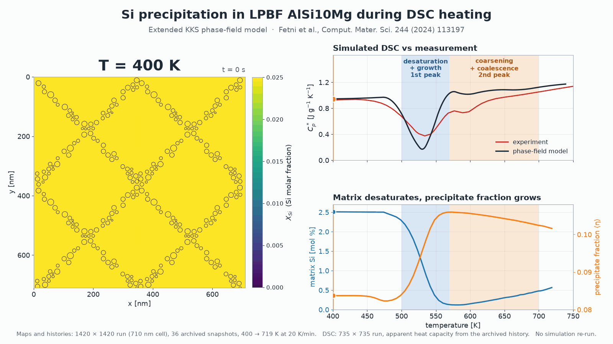
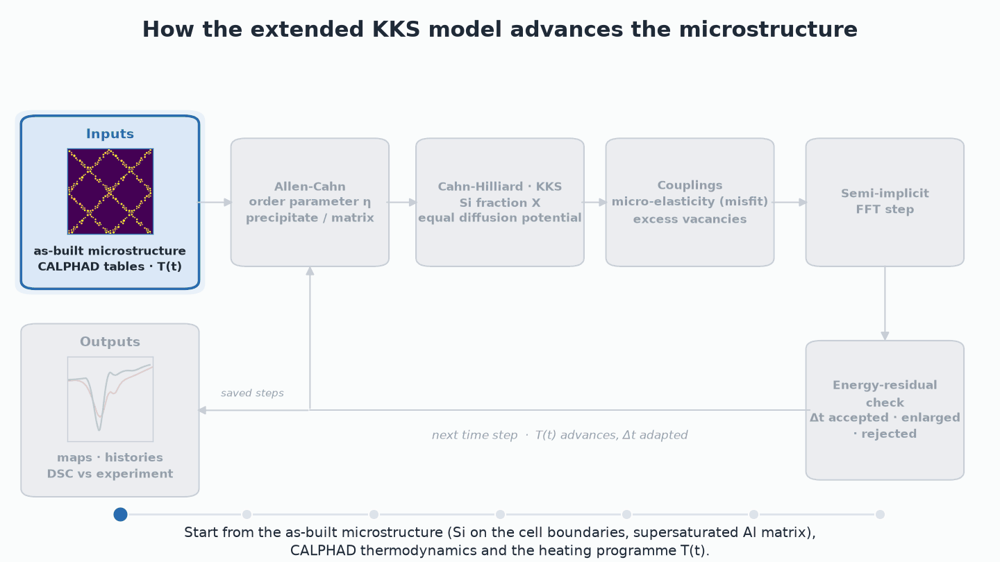
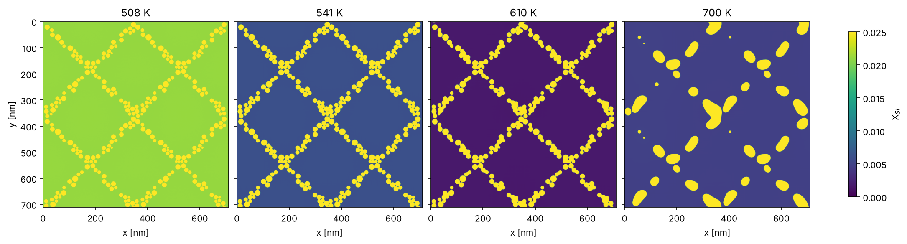
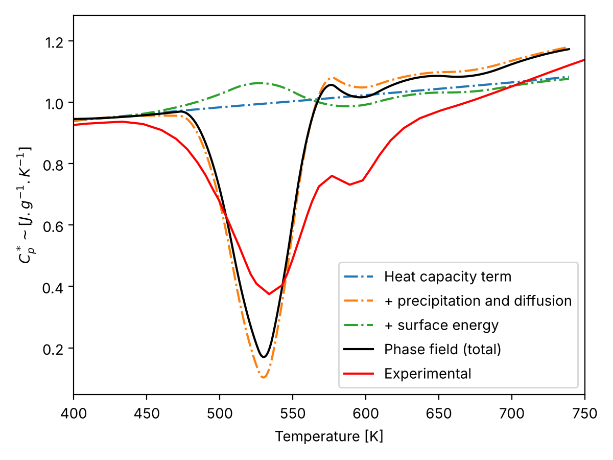
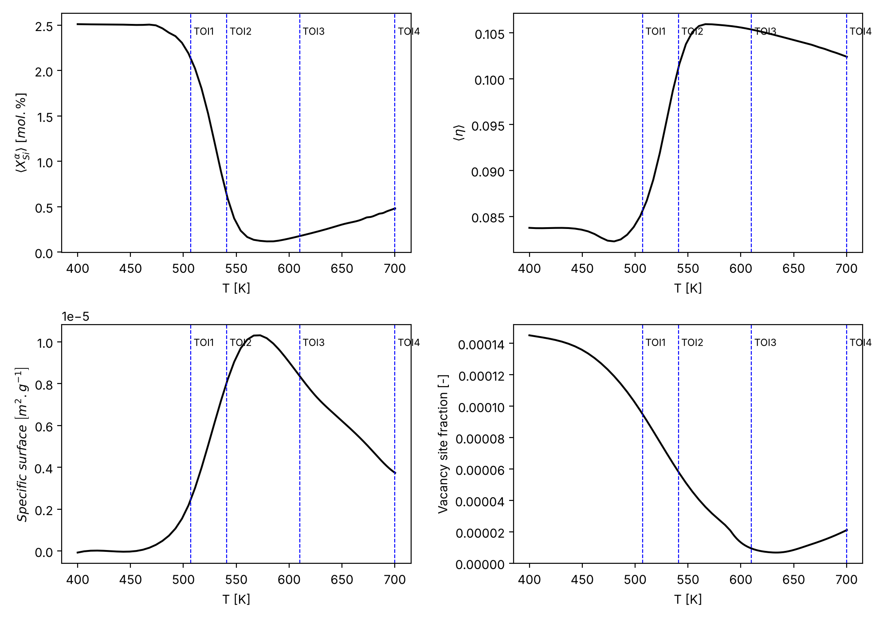
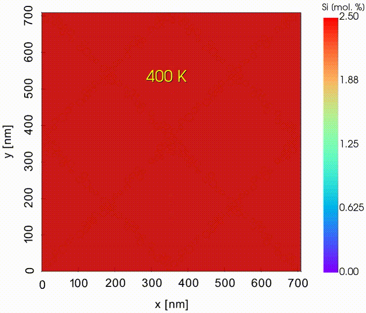

# Extended KKS Phase-Field Model — Si precipitation in LPBF AlSi10Mg

An extended Kim-Kim-Suzuki (KKS) phase-field model of the growth and coarsening
of Si precipitates in the supersaturated Al matrix of laser powder-bed fusion
(LPBF / SLM) AlSi10Mg during non-isothermal heating, and the simulated DSC
(differential scanning calorimetry) curve derived from it. It accompanies:

> S. Fetni, J. Delahaye, H. Sepúlveda, L. Duchêne, A.M. Habraken, A. Mertens,
> *Extension of a phase-field KKS model to predict the microstructure evolution in
> LPBF AlSi10Mg alloy submitted to non isothermal processes*, Computational
> Materials Science **244** (2024) 113197.
> [DOI](https://doi.org/10.1016/j.commatsci.2024.113197) ·
> [preprint](docs/Preprint-2407.11580v1.pdf)

<p align="center">
  
</p>

*Si molar fraction of the archived 1420 × 1420 run, heated at 20 K/min, with the
simulated DSC (735 × 735 run) against the measurement, and the matrix Si content
and precipitate fraction. All panels come from the archived results; nothing was
re-simulated.*

This release is a new version of the published code. **The model, its
parameters and the published results are unchanged**: no simulation was re-run
to produce this release. The implementation is reorganised into a tested Python
package, driven by configuration files, and verified to reproduce the original
code to the last bit and the archived 2022 run to round-off
([Verification](#verification)). The large simulation outputs moved to a Zenodo
record ([Data](#data)).

## The model in brief

<p align="center">
  
</p>

A 2-D periodic cell of the as-built microstructure — Si particles decorating the
cell boundaries of the Al matrix, supersaturated with Si — is heated from 400 K
to 850 K at 20 K/min, as in a DSC test. The model couples

* an **Allen-Cahn** equation for the order parameter `η` (0 in the matrix, 1 in
  the Si precipitates) and a **Cahn-Hilliard** equation for the Si molar fraction
  `X`, in the KKS formulation (phase compositions at equal diffusion potential);
* **temperature-dependent** CALPHAD-based free energies, interface energy, misfit
  strain, molar volume and elastic constants;
* **micro-elasticity** (Khachaturyan) for the precipitate misfit;
* an **excess-vacancy** model: the vacancies frozen in by the fast LPBF
  solidification accelerate Si diffusion and anneal out during heating;
* an **energy-residual adaptive time step**.

Both equations are solved semi-implicitly with FFTs. The DSC signal is then built
from the evolution of the matrix Si content, the precipitate fraction and the
interface area (heat-capacity, precipitation and interface-energy terms).



*Si molar fraction of the 710 nm cell (1420 × 1420 grid) at the four temperatures
of interest of the article: matrix desaturation (508 → 610 K), then coarsening
and coalescence of the precipitates (700 K). Rendered from the archived maps.*

 

*Left: simulated DSC (apparent heat capacity) and its contributions, compared
with the measurement (735 × 735 run). Right: matrix Si content, precipitate
fraction, interface measure and vacancy site fraction during heating (1420 × 1420
run), with the temperatures of interest. Both figures are computed from the
archived histories by `scripts/make_figures.py`.*

The governing equations, the numerical scheme, the parameters and the
implementation notes are in the **[Technical Report](TECHNICAL_REPORT.md)**.

## Installation

Python ≥ 3.10.

```bash
pip install -e ".[fftw,test]"      # numpy, scipy, numba, matplotlib, pyFFTW, pytest
```

pyFFTW is optional. Without it NumPy's FFT is used, and results differ from the
archived runs only at machine precision. `requirements-lock.txt` lists the exact
versions this release was validated with.

## Usage

```bash
# Figures from the archived histories (seconds, no simulation)
python scripts/make_figures.py --out figures

# Resolved configuration of the archived reproducible run (no simulation)
pf-kks-run configs/reproducible_run.toml --print-config

# Short demonstration: 160 x 160 cell, 2000 steps up to ~450 K (~5 min on 4 cores)
pf-kks-run configs/demo_small.toml --out outputs/demo

# The archived reproducible run: 735 x 735, 30 000 steps (~40 h on one HPC node)
pf-kks-run configs/reproducible_run.toml --out outputs/reproducible_run

# Images of the X_Si and eta fields of every map in a directory
python scripts/plot_maps.py outputs/demo/saved_maps --out figures/maps
```

`pf-kks-run` is installed with the package. `python scripts/run_simulation.py`
does the same without installing. A run writes `saved_maps/map*.npz` (full-field
snapshots; they can seed a new run but are not exact restart points, see the
[Technical Report](TECHNICAL_REPORT.md#outputs)), `history.npz` (per-step histories and
residuals), `log.txt` and `dtime.txt` (the original log formats) and the resolved
`config.json`.

All parameters live in the TOML file; `configs/reproducible_run.toml` documents
each of them. The library can also be used directly:

```python
from pf_kks import solver
from pf_kks.config import load_config
from pf_kks.microstructure import load_precipitates, place_precipitates

cfg = load_config("configs/demo_small.toml")
ox, oy, oz, r = load_precipitates("data/inputs/micro_final.npz")
state = place_precipitates(cfg.nx, cfg.ny, cfg.nz, cfg.dx, cfg.dy, cfg.dz,
                           cfg.x_matrix, cfg.x_precipitate, r, ox, oy, oz)
result = solver.run(cfg, *state, out_dir="outputs/demo", base_dir="configs")
```

### Computing resources

The 735 × 735 run takes about 5 s per step on one node (30 000 steps ≈ 40 h on
the NIC5 cluster in 2022). Memory peaks at about 2.5 GB, dominated by the elasticity
solver. Small grids run on a laptop.

## Verification

No simulation was re-run for this release. The refactored code is checked
against the original instead:

| Check | What is compared | Result |
|---|---|---|
| Solver equivalence (`tests/test_solver_equivalence.py`) | original `pyFi_adapt.main` vs `pf_kks` on 64 × 64 grids, through every branch of the time loop: fixed steps, accepted / enlarged / rejected adaptive steps, abort | fields, all histories, saved maps (keys, dtypes, values) and log files **bit-identical** |
| Archived run, step 1 (`tests/test_archived_run.py`, slow) | `pf_kks` on the 735 × 735 reproducible-run configuration vs the map saved by the 2022 run | identical file name and keys; max difference 9e-16 |
| Archived run, 20 steps (slow) | per-step histories vs those stored in the final 2022 map | time, temperature, interface measure identical; compositions and phase fraction within 2e-14 (relative) |
| Thermodynamics (`tests/test_thermo_equivalence.py`) | `pf_kks.thermo` vs `free_nrj_mob.py`, 30 Gibbs-energy outputs, molar volumes, elastic constants, mobilities | bit-identical |
| DSC (`tests/test_dsc_equivalence.py`) | `pf_kks.postprocess.dsc` vs the cells of `compute_DSC.ipynb` run on the archived history | bit-identical |
| Nucleation (`tests/test_nucleation_equivalence.py`) | classical nucleation rate vs the original `nucle` | bit-identical |

```bash
pytest              # fast suite (~1 min)
pytest -m slow      # full-size checks against the archived run (~4 min)
```

The original code was also re-run today on the first step of the archived run.
It reproduces the 2022 map to the same round-off, which confirms the archived
run, its inputs and the original code are consistent.

## Data

| Location | Content |
|---|---|
| `data/inputs/` | material tables (`final_export.npz`) and initial precipitates (`micro_final.npz`, text files) |
| `data/histories/` | per-step histories (time, temperature, mean compositions, phase fraction, interface measure) of the seven archived runs, about 9 MB in total; enough for the DSC and evolution figures |
| `data/experimental/` | measured DSC curve |
| `data/reference/` | first-step map and log of the reproducible run (used by the tests) |
| Zenodo record [10.5281/zenodo.23300608](https://doi.org/10.5281/zenodo.23300608) | all 2.3 GB of full-field maps of the seven runs, rendered figures, the original `ReproducibleRun.zip` |

See **[DATA.md](DATA.md)** for the runs, formats and provenance. Every file of
the original repository is listed with its checksum and new location in
[`provenance/ORIGINAL_INVENTORY.tsv`](provenance/ORIGINAL_INVENTORY.tsv).

## Repository layout

```text
pf_kks/                 the model (library)
  solver.py               time integration (Allen-Cahn + Cahn-Hilliard, adaptive step)
  free_energy.py          KKS free energy, phase compositions
  elasticity.py           Khachaturyan micro-elasticity
  kinetics.py             diffusivity, vacancies, interface mobility, normalisation
  thermo.py               CALPHAD Al-Si thermodynamics
  nucleation.py           classical nucleation (optional)
  postprocess/            DSC, smoothed histories, plots
configs/                run configurations (TOML)
scripts/                run, figures, maps, data-provenance scripts
tests/                  equivalence, archived-run and component tests
data/                   inputs, histories, experiment, reference
media/                  animated overview and model loop, figures, supplementary animation
legacy_version/         original published code (code only)
provenance/             inventory of the original repository, Zenodo record README
docs/                   preprint of the article
TECHNICAL_REPORT.md     equations, numerics, parameters, implementation notes
DATA.md                 data description and provenance
```

## Original code

The original code is preserved in [`legacy_version/`](legacy_version/) for
lineage: the solver and run scripts, the notebooks (outputs cleared) and the DSC
tool. The tests run the original code side by side with the package.

## Contributors

Code developed at ULiège by Jocelyn Delahaye (PhD thesis: *How to feed and
validate a phase-field model predicting the evolution of microstructures and
properties in AlSi10Mg processed by Selective Laser Melting*, ULiège, 2022,
[ORBi](https://orbi.uliege.be/handle/2268/293324)) and Seifallah Fetni (post-doc,
IN IPD-STEMA 2019 grant and faculty post-doc grant 2021).

## Citation

Please cite the article (see [`CITATION.cff`](CITATION.cff)):

```bibtex
@article{FETNI2024113197,
  title   = {Extension of a phase-field KKS model to predict the microstructure evolution
             in LPBF AlSi10Mg alloy submitted to non isothermal processes},
  author  = {Seifallah Fetni and Jocelyn Delahaye and Héctor Sepúlveda and Laurent Duchêne
             and Anne Marie Habraken and Anne Mertens},
  journal = {Computational Materials Science},
  volume  = {244},
  pages   = {113197},
  year    = {2024},
  doi     = {10.1016/j.commatsci.2024.113197}
}
```

## License

Apache License 2.0 — see [`LICENSE`](LICENSE).

## Supplementary video

Microstructure evolution of LPBF AlSi10Mg during non-isothermal heating: matrix
desaturation, then growth and coalescence of the Si precipitates.


